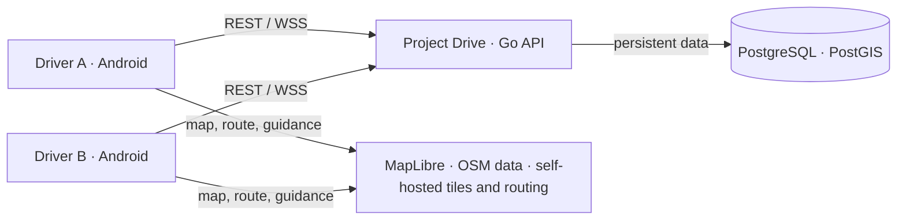
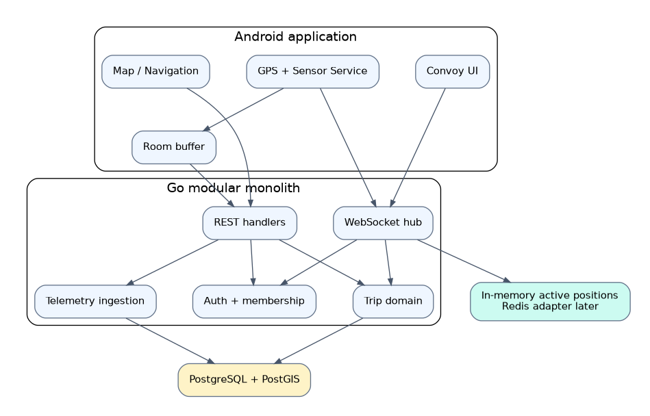
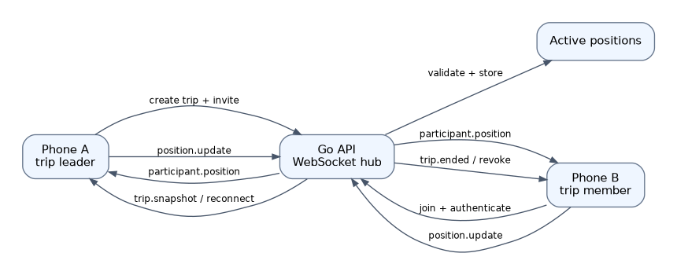
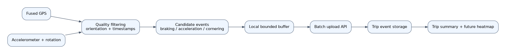
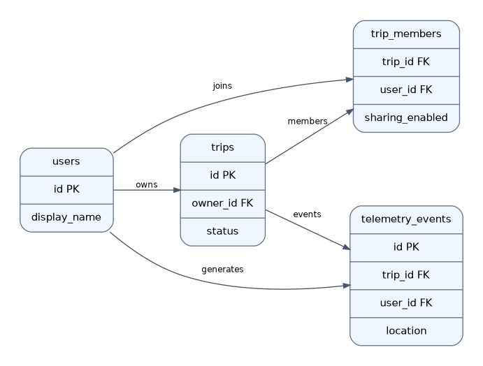
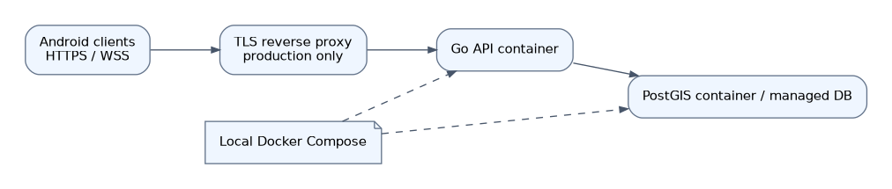

# Project Drive — Architecture Designs

Version 1.1 · 2026-11-13

These diagrams are implementation references. Graphviz `.dot` sources are editable. Phase 0 uses a single Go API instance and in-memory live state; Redis and multi-instance fanout are future work.

## System context

Map rendering and routing use open-source components and OSM-derived data behind Android adapters; the Go backend owns private trips, authorization, telemetry and convoy state. Tiles, routing and geocoding are self-hosted for production.

## Container and module architecture

All WebSocket subscriptions and publishes pass server-side identity and trip membership checks. The Room buffer supports intermittent connectivity.

## Live convoy message flow

On join/reconnect send an authorized snapshot, then incremental updates. Reject out-of-order or invalid positions; revoke access when membership or sharing ends.

## Telemetry processing pipeline

Phone sensor values are estimates. Detect candidate events only after time synchronization, gravity/orientation handling and signal-quality filtering.

## Core persistent entity relationships

PostGIS geography points store trip endpoints and selected telemetry locations. Live positions are ephemeral, not permanent by default.

## Cloud-neutral deployment topology

Local development uses Docker Compose; production requires TLS termination, secret management, backups, observability and secure authentication.

## Architecture decisions and constraints

- ADR-001: Go modular monolith, domain modules separated from REST and WebSocket transports.
- ADR-002: PostgreSQL/PostGIS persists trips, membership and selected telemetry; in-memory active positions in Phase 0.
- ADR-003: Open map and routing components are behind Kotlin `NavigationEngine` and map-data adapters; evaluate OSM coverage in Kenya, licenses, attribution, data refresh and self-hosting requirements before selection. MapLibre and Valhalla are candidates.
- ADR-004: Trip-scoped WebSockets; server derives user identity, enforces membership, applies rate limits, validates coordinates and timestamps.
- ADR-005: Location sharing is opt-in and revocable; old locations are visibly stale.
- ADR-006: Sensor capture stays on device; upload bounded batches of derived events, with future OBD-II source adapter.

## Non-functional data flows

**Location update:** GPS -> client filtering -> authenticated WebSocket -> membership and plausibility checks -> active state -> authorized participant broadcast.

**Telemetry:** GPS/IMU -> orientation and quality processing -> local event detector -> bounded local buffer -> HTTPS batch -> persistent events -> trip summary.

**Road report (Phase 1):** report submission -> server validation -> PostGIS storage -> proximity/route query -> client map overlay -> confirmation/expiry pipeline.

**Heatmap (Phase 3):** consented retained trip traces -> map matching / spatial aggregation -> per-user road segments -> authorized heatmap queries and deletion.

## Architecture validation gates

1. Two devices join one private trip and exchange authorized live positions.
2. A non-member cannot subscribe to the trip stream.
3. A reconnect yields a snapshot and never overwrites a newer position with an older one.
4. Revoking sharing stops publication and prevents future access.
5. Navigation remains isolated from backend trip and telemetry implementations.
6. Docker Compose starts API and PostGIS, and migrations run reproducibly.
